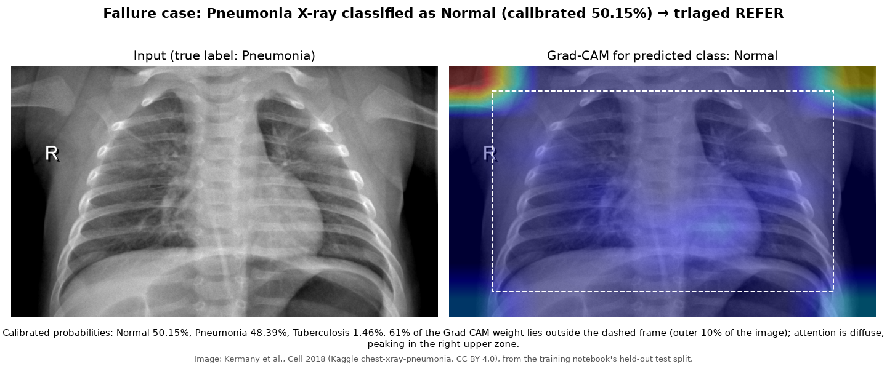

# Clinical Diagnostic Portal

A Streamlit app that classifies chest X-rays as **Normal**, **Pneumonia** or **Tuberculosis**. It reports a calibrated probability, flags uncertain cases for clinician review, shows where the model looked (Grad-CAM), and can generate a plain-language report with an LLM.

> **Not a medical device.** This is a research/portfolio project. Its output is a screening aid, not a diagnosis.

**Live:**

| What | URL | Hosting |
| --- | --- | --- |
| Streamlit app | [clinical-diagnosis.streamlit.app](https://clinical-diagnosis.streamlit.app/) | Streamlit Community Cloud, deployed from `main` |
| React app | [clinical-diagnostics.vercel.app](https://clinical-diagnostics.vercel.app/) | Vercel |
| API (FastAPI) | `https://<random>.trycloudflare.com/docs` | The author's PC, behind a Cloudflare quick tunnel ([why](#deployment)) |

The React app works only while that PC is on: the API isn't on a cloud host yet, and its tunnel URL changes when it restarts. The Streamlit app runs on its own and is always available. See [Deployment](#deployment).

## How it works

1. **Classifier:** an EfficientNet-B0 "student", distilled from DenseNet121 and Swin-T teachers (`notebooks/sta-project-ca2693.ipynb`). Input is 224×224 with CLAHE contrast enhancement.
2. **Calibration and triage:** raw probabilities are rescaled with a single temperature fitted on the validation split. If the top calibrated probability is below **0.9**, the result is marked **refer: uncertain, clinician review recommended**.
3. **Grad-CAM:** computed on the last convolutional layer, summarised as the most influential zone of the image.
4. **Report agent:** an LLM (Groq `openai/gpt-oss-120b` by default) gathers facts through three tools: classifier output, Grad-CAM summary, and the project's fixed condition text (a draft that a clinician hasn't reviewed yet; see [Known limits](#known-limits)).
   - A guard rejects any report whose class, probability or status differs from the classifier, that claims a confirmed diagnosis, or that leaves out the dataset caveat from the condition-info tool.
   - After one retry, a fixed template report is used instead.
   - The LLM never sees the image or patient details, and can't change the prediction.
5. **Logging:** predictions, triage status and step-level traces (latency, tokens, guard verdicts) go to Supabase, with per-user row-level security, and to local JSONL.

## Results and failure cases

### Classifier and calibration

The test split is the training notebook's own held-out set (1,006 images), rebuilt from the exported manifest in `splits/`. Accuracy matches the paper's reported 97.61%.

| Metric | Value |
| --- | --- |
| Accuracy / macro-F1 | 97.61% / 98.27% |
| Recall: Normal / Pneumonia / TB | 98.6% / 96.0% / 100% |
| Calibration error (ECE, 15 bins) | **39.5% → 1.2%** after temperature scaling (T = 0.132) |
| Referred at the 0.9 threshold | 1.7% of images; catches 11 of the 24 errors |

The raw model was strongly **under**-confident: its probabilities never reached 0.9. Calibration fixes the numbers but not the decisions, because accuracy is unchanged by temperature scaling. Details are in [`outputs/calibration.json`](outputs/calibration.json) and [`outputs/reliability.png`](outputs/reliability.png).

### Report agent eval

36 test cases, made up of every model error, every refer case, and 6 correct ones. Latest run: [`evals/results/2026-10-26.md`](evals/results/2026-10-26.md).

- **Deterministic checks: 12 of 12 at 100%.** These are: class, probability and status match the classifier; refer cases recommend clinician review; confident results are never called uncertain; Pneumonia/TB reports never say no follow-up is needed; no confirmed-diagnosis claim; the dataset caveat is quoted from the tool; limitations present; length limits; schema valid; and the guard still agrees with the decisions recorded in the run.
  - CI replays this run, and the multi-agent run below, on every push and fails if any rate drops in either.
- All 36 reports were written by the LLM, with no template fallbacks. The guard rejected 2 drafts (`c35`, `c36`: confident TB results whose recommendation opened with "Refer:"), and both were fixed on the one retry.
- An LLM judge (`qwen/qwen3.8-27b`, a different model family from the report writer) scored 4.64–5.0 out of 5 on faithfulness, uncertainty language, actionability and plain language.
- **Judge vs human:** I scored 15 reports blind (from the 18 Oct run) with the same rubric. They agree on 82% of scores exactly and 97% within one point, but both of us rated almost everything 5, so that number is flattering.
  - The one report I marked down (`c32`: "No immediate referral is required" for a 99.99% Pneumonia result) got 5/5 from the judge on faithfulness and actionability.
- **Judge sensitivity:** given 5 deliberately bad reports (wrong class, missing referral, TB "no follow-up needed", overconfident wording, invented symptom), the judge scored the broken part 1/5 in **all 5** ([`evals/judge_sensitivity.md`](evals/judge_sensitivity.md)). The guard blocks 3 of them.
- **Overall: the judge catches blatant errors but misses subtle ones** (`c32`, and `c07`'s invented limitations). So every problem a human finds becomes a deterministic check, and where possible a guard rule.

### Failure case: confidently wrong



This pneumonia X-ray is called Normal at 50.15%, so it is correctly **referred**. But 61% of the Grad-CAM weight lies on the image border, around the shoulders and corners, not in the lungs.

**13 of the 24 errors are confident** (not referred). For example, a Normal X-ray is called Pneumonia at 99.97%. The report for such a case faithfully says "very high confidence", and the eval scores it 5/5, because the eval checks the report against the classifier, not the truth. No report-level check can catch these.

### Things the evals caught

- **Guard false positive.** Gemini wrote "a screening aid, *not* a confirmed diagnosis", and the guard rejected it as a diagnosis claim. The guard now ignores negated mentions in the same clause. That exact output is a regression test (`tests/fixtures/`).
- **Ungrounded caveat.** In the pilot, the judge marked down a report for saying the model was evaluated on "two public datasets". The fact was true, but it came from the agent's instructions rather than any tool output. It was moved into a tool, so it's now grounded.
- **Dismissed follow-up (found by human review, missed by the judge).** `c32` said "No immediate referral is required" for a 99.99% Pneumonia result. The guard now rejects any Pneumonia/TB report that says no referral, action or follow-up is needed, and the template always recommends clinician follow-up. In the latest run, `c32` reads "Clinician follow-up is advised…".
- **My own regression (found by the judge, missed by the guard).** The first prompt wording for that rule made 5 of 8 confident Pneumonia/TB reports open with "Refer: uncertain…", calling 99.99% results uncertain. The judge scored them 1–2. The prompt was fixed and the guard now rejects it; that run is kept as evidence (`evals/runs/20261020T071107Z`).
- **Missing dataset caveat (found by an eval check, missed by the guard and the judge).** `c07` skipped the condition-info tool and invented its own limitations ("may be affected by image quality, positioning…"), dropping the dataset/source-confound caveat; the judge gave it faithfulness 5. The guard now reads the caveat from the tool itself and rejects any report that doesn't quote it, whichever tools the model called, and its rejection message quotes the text to copy on the retry. That exact report is a fixture, and in the next run (`20261026T040807Z`) all 36 reports carry the caveat.

### Known limits

- **Source confound:** each disease comes from a different dataset (pneumonia: pediatric JPEGs; TB: adult PNGs; Normal: both). The model may partly learn the source. Normal recall is 100% on images from the TB dataset but 95.1% on images from the pneumonia dataset, and every metric above is in-distribution.
- **Slow reports:** about 58 s each on Groq's free tier, mostly waiting to stay under the 8k tokens/min limit (4 sequential LLM calls per report).
- **Grad-CAM** is coarse (a 3×2 grid, not a lung segmentation) and usually diffuse.
- **The model can skip a tool.** In the default single-agent pipeline, nothing forces the report model to call all three tools (`c07` skipped one in the 20 Oct run). The guard now blocks the missing dataset caveat that caused, but it doesn't check that region text came from `get_gradcam`. The experimental multi-agent pipeline (below) re-asks once for a skipped tool and otherwise uses the template.
- **Unreviewed medical text:** the condition text in `agent/condition_info.json` is a draft that hasn't been reviewed by a clinician. The judge model is a Groq *Preview* model.

### Multi-agent report pipeline (experimental, off by default)

`REPORT_PIPELINE=multi` swaps the single report agent for three agents run by an orchestrator ([`agent/multi_agent.py`](agent/multi_agent.py)). The single agent stays the default: in a full comparison it had fewer template fallbacks (below).

1. **Evidence agent** (`gpt-oss-120b`, tool calls): must call all three tools. If it stops early, it is asked once more, naming the missing tool; otherwise the template report is used.
2. **Writer** (`gpt-oss-120b`, no tools): writes the report as strict JSON from the tool outputs only, including the dataset caveat.
3. **Guard:** the same deterministic checks as before, on every draft.
4. **Verifier** (`gpt-oss-20b`, a separate Groq budget): checks each claim against the tool outputs. An unsupported claim sends the draft back once.
5. **Guard again** on the final report: it has the last word, even after the verifier approves.

Every step is a trace span (agent, tokens, latency, verdict), and each agent has its own time limit.

**Single vs multi on the same 36 cases** ([`evals/results/2026-10-27_single_vs_multi.md`](evals/results/2026-10-27_single_vs_multi.md); single run `20261026T040807Z`, multi run `20261027T000140Z`, same judge):

| | Single | Multi |
| --- | --- | --- |
| Deterministic checks at 100% | 12 of 12 | 12 of 12 |
| Template fallbacks | **0** | **3** |
| Judge means (faithfulness / uncertainty / actionability / plain language) | 5.00 / 4.81 / 5.00 / 4.64 | 4.86 / 4.81 / 4.81 / 4.61 |
| Guard rejections; verifier revisions | 2; — | 0; 2 |
| gpt-oss-120b tokens per report; gpt-oss-20b | 5,249; — | 3,614; 1,795 |
| Latency per report, median / p90 | 58.8 s / 60.0 s | 54.7 s / 59.8 s |
| Nominal cost, 36 reports (billed $0 on the free tier) | $0.034 | $0.038 |

- **Why single stays the default:** the rule was to switch only if multi ties or beats single on every deterministic check *and* has no more fallbacks. All 3 multi fallbacks came from the verifier's JSON: gpt-oss-20b failed Groq's strict schema on 12 of 47 calls (an out-of-list `source` value), and the one retry didn't fix 3 of them.
- **Also worse in multi:** 9 of 33 reports list the dataset caveat twice (a writer-prompt artifact), and `c19` got actionability 1 from the judge.
- **What the verifier adds:** on the 5 planted bad reports it flagged all 5, each on the planted claim, with no false alarms on the 3 originals ([`evals/verifier_sensitivity.md`](evals/verifier_sensitivity.md)); the guard alone stops 3. Live, it sent back 2 Normal reports that said no follow-up was needed, which the guard allows. A second model agreed with both flags. The guard still matters too: the verifier would have passed both drafts the guard rejected in the single run.
- **Judge noise:** re-scoring 5 single-run reports a day later left 12 of 20 scores unchanged (mean change 0), so most per-criterion differences above are within ±1 noise.

## Why the eval runner is async (and why that isn't threads)

Each eval case has two steps: the **report model** writes a report (about 58 s, almost all of it *waiting*, for the network and for Groq's 8,000-tokens-per-minute limit), then the **judge model** scores it (about 1 s, also waiting). The old runner did one thing at a time: report 1, judge 1, report 2, judge 2, and so on.

The new runner uses Python's `asyncio`. While report 2 is being written, judge 1 is already being scored. Think of one cook who puts the pasta on to boil and chops the salad while the water heats: there's still only one cook, but no time is lost standing at the stove. In the code:

- **One worker, two jobs.** One loop writes reports; one judge job scores whatever is ready. Whenever either is waiting for a reply or a rate-limit timer, the other runs.
- **Not threads.** Nothing runs at the same instant. The work is waiting, not computing, so threads would add risk (two threads writing the same results file or sharing one rate-limit budget) without making it faster.
- **Limits still hold.** Each model keeps its own token-aware budget. An `asyncio.Lock` makes waiters queue in order, an `asyncio.Semaphore` allows one request per model at a time, and every request has a timeout.
- **Same results.** Tests with fake clients show the records are identical to the old runner's; only the order of lines in the run file can differ. Resume, stop and fallback behave as before. `--sync` still runs the old way.

Simulated benchmark, 5 cases, fake clients with real timings scaled down ([`evals/results/benchmark_simulated.md`](evals/results/benchmark_simulated.md)):

| Scenario | Old (sync) | New (async) | Speed-up |
| --- | --- | --- | --- |
| Real ratio: report ~58 s, judge ~1 s | 293 s | 291 s | **1.01×** |
| Slow judge: 15 s | 363 s | 305 s | 1.19× |
| Equal times (best case) | 576 s | 348 s | 1.65× |

The honest result: with today's timings, async saves about 1%, because overlap can only hide the judge's time. The slow part is the report model waiting on its own token limit, and that can't overlap with itself. Async pays off when the judge is slow (a reasoning judge, or one hitting its own limits). The live benchmark is `python -m evals.benchmark --live`; it hasn't been run yet.

## Run it locally

```bash
git clone https://github.com/adi13apr/Clinical-Diagnostics-.git
cd Clinical-Diagnostics-
python -m venv venv && venv\Scripts\activate      # macOS/Linux: source venv/bin/activate
pip install -r requirements-dev.txt               # app + tests
streamlit run app.py
```

`.streamlit/secrets.toml` (never commit it):

```toml
[supabase]
url = "..."
key = "..."        # publishable key (sb_publishable_...), never the secret/service_role key
redirect_url = "https://clinical-diagnosis.streamlit.app/"   # where Google sign-in returns (local: http://localhost:8501/)

[groq]             # optional: without it, reports use the template
api_key = "..."
```

Run `sql/001`–`005` in the Supabase SQL Editor before deploying.

**Google sign-in** needs three settings outside the code:
1. Supabase → Authentication → Providers → **Google**: enable it, and paste a Google Cloud OAuth client ID and secret.
2. Supabase → Authentication → URL Configuration → **Redirect URLs**: add `https://clinical-diagnosis.streamlit.app/**` and `http://localhost:8501/**`.
3. Google Cloud Console → that OAuth client → **Authorized redirect URIs**: add `https://<project-ref>.supabase.co/auth/v1/callback`.

| Task | Command |
| --- | --- |
| Tests (no network, data or GPU) | `pytest` |
| Re-score the committed eval run (what CI runs) | `python -m evals.run --replay` |
| Live eval (needs `data/` and a key) | `python -m evals.run --live` (async; add `--sync` for the old runner) |
| Old vs new runner, simulated / live | `python -m evals.benchmark --simulated` / `--live` |
| Re-fit calibration (needs the Kaggle datasets in `data/`) | `python scripts/calibrate.py` |

`CLAUDE.md` describes the code layout and conventions in detail.

## API (backend for the React UI)

`api/` is a FastAPI server built on the same services as the Streamlit app: same model, calibration, report agent (cache, guard, fallback), tracing and Supabase tables. The Streamlit app is unchanged.

| Endpoint | What it does |
| --- | --- |
| `POST /predict` | Upload a JPEG/PNG (max 10 MB). Returns class, calibrated probabilities, `confident`/`refer`, and a `trace_id` |
| `GET /gradcam/{trace_id}` | Grad-CAM figure (PNG) for that upload |
| `GET /gradcam/{trace_id}/map` | The raw 7×7 Grad-CAM map plus a region summary (JSON), so a client can draw its own overlay |
| `POST /report/{trace_id}` | Start an AI report (same guard and template fallback as the app). Returns a job; see "Reports" below |
| `GET /report/jobs/{job_id}` | Status of a report job (`queued`, `running`, `done`, `failed`) and the report once it's done. Only its owner can read it |
| `GET /history` | Your past predictions: `limit`, `offset`, `label`, `status`, `date_from`, `date_to` |
| `GET /analytics` | Daily volume, referral rate, average latency per pipeline step |
| `GET /traces/{trace_id}` | Every step of one prediction, for the trace viewer |
| `GET /health` | Is the model loaded and calibrated; is the LLM configured. No login needed |

- **Login:** every endpoint except `/health` needs `Authorization: Bearer <Supabase access token>`. The server checks the token, then queries Supabase *as that user*, so row-level security returns only their own rows.
- **Uploads stay in memory.** They're never written to disk, and `/gradcam` and `/report` can use them for an hour. After a restart, call `/predict` again.
- **Several replicas:** set `REDIS_URL` and the uploads, Grad-CAM results and LLM report cache are shared through Redis (same 1-hour expiry; reports 24 hours), so any replica can serve any request. The LLM rate limits (requests and tokens per minute, daily caps) are shared the same way, so replicas together stay within one Groq quota. Run Redis **without persistence** (`--save "" --appendonly no`), otherwise the X-rays end up on Redis's disk. Without `REDIS_URL`, everything stays in the process as before. The Streamlit app never uses Redis.
- **History** comes from the `predictions` log, so it has no patient names.
- **Reports.** A report takes about a minute on Groq's free tier, so there are two ways to run them:
  - **One container, no `REDIS_URL` (inline):** `POST /report` writes the report while the request waits and answers `200` with `status: "done"` and the report. Nothing else to run.
  - **With `REDIS_URL` (queue):** `POST /report` answers `202` straight away with a `job_id`, and a separate **report worker** process writes the report. The client polls `GET /report/jobs/{job_id}` (the web app does every 2 s). Asking again for the same prediction while its job is queued or running returns the same job; after a failure it starts a new one. API replicas never wait on the LLM, and workers scale on their own. Jobs keep only ids (no report text, image or token); finished jobs are kept 1 hour, failed ones 24 hours. If a worker dies mid-report, the job turns `failed` within about 4 minutes instead of staying "running".
  - The worker never connects to Supabase and holds no user token or service key. It keeps the report's trace in Redis, and the API saves it to Supabase *as the user* on the poll that sees the job finish (needs `sql/006_traces_unique_span.sql`, so repeated saves can't duplicate spans).
  - Run the worker with the same image: `docker compose up --build` starts Redis, two API replicas behind nginx and one worker (`--scale worker=3` for three; see [Several replicas](#several-replicas-docker-compose)). RQ workers don't run on Windows, so use Docker there.

```bash
pip install -r requirements-api.txt
uvicorn api.main:create_app --factory --port 8000     # docs at http://localhost:8000/docs
```

Locally it reads `.streamlit/secrets.toml`. On a server, it uses environment variables:

| Variable | Meaning |
| --- | --- |
| `SUPABASE_URL`, `SUPABASE_KEY` | Project URL and publishable key (required) |
| `SUPABASE_JWT_SECRET` | Only for projects still on the legacy HS256 JWT secret. Without it, those tokens are checked by asking Supabase (one extra request each) |
| `FRONTEND_URL` | Deployed React app's origin(s), comma-separated. `localhost` on any port is always allowed |
| `GROQ_API_KEY` | Optional. Without it, reports use the template |
| `MAX_UPLOAD_MB` | Default 10 |
| `REDIS_URL` | Optional, e.g. `rediss://:password@host:6380/0`. Shares uploads, the report cache and LLM rate limits between replicas, and queues reports for report workers, so **run at least one worker** when it's set (also read from `[redis] url` in `secrets.toml`) |

Hosting options for the API are in [Deployment](#deployment).

## Several replicas (Docker Compose)

`docker-compose.yml` runs the API as separate services on one machine: Redis 7, two API replicas, report workers (scalable), and nginx as a round-robin load balancer on a single port. Every API response carries `X-Served-By` (the replica's container ID), and nginx adds `X-Upstream-Addr`.

```powershell
Copy-Item .env.example .env; notepad .env               # Supabase URL + publishable key, Groq key, demo login
docker compose up --build -d                            # redis, 2 x api, 1 worker, nginx on 127.0.0.1:7861
docker compose up -d --scale worker=3 --no-recreate     # 3 workers; api stays at 2
python scripts/multi_replica_demo.py --jobs 3           # the measurements below
docker compose logs -f api                              # or worker, nginx, redis
docker compose down
```

`scripts/multi_replica_demo.py` drives the stack through nginx with a real Supabase login, reads Redis directly, and saves the raw numbers to `demo_results/`.

### What we measured

Two runs on 2026-10-25, same setup: Windows 11, Docker Desktop, 2 API replicas, 3 workers, real Supabase and Groq (`openai/gpt-oss-120b`, limits 30 requests and 8,000 tokens per minute). **Before** (21:37 UTC) is the run that found the problem; **after** (23:59 UTC) ran with the budget fix described below. Every number comes from those runs' output files and their trace spans.

**Load balancing.** In both runs, six `/health` calls were answered by both replicas in strict alternation (A, B, A, B, A, B).

**Shared state** (after; before gave the same results).
- The X-ray was predicted on replica A.
- The Grad-CAM map request went to replica B and got `200`: B found A's upload in Redis.
- The Grad-CAM image took two requests (A, then B), both `200`.
- `POST /report` on A queued a job. The same request on B returned **the same job id** (by then `running`), so no duplicate was queued.
- One of the three worker containers wrote the report with the LLM. Four polls were spread over both replicas.

**Shared Groq budget, 3 reports at once** (pixel-different images, so the report cache couldn't answer):

| | Before | After | Limit |
| --- | --- | --- | --- |
| Output tokens reserved per call (`max_completion_tokens`) | 2,000 | 600 | |
| Job timeout (RQ) | 180 s, fixed | 300 s, derived for 3 workers | |
| LLM calls | 15 (21:38:02 to 21:41:07 UTC) | 16 (23:59:43 to 00:02:43 UTC) | |
| Completion tokens per call: min / median / max | 21 / 27 / 217 | 21 / 26 / 229 | |
| Most requests in any 60 s | 5 | 6 | 30 |
| Most tokens in any 60 s | 5,478 | 7,124 | 8,000 |
| Tokens in total: Redis counters / trace spans | 18,742 / 18,742 | 20,511 / 20,511 | |
| Groq rate-limit errors or retries (429) | 0 | 0 | |
| All three jobs ended within | 182 s | 176 s | |
| **Reports written by the LLM** | **2 of 3** (1 `JobTimeoutException`) | **3 of 3** | |

- **Before:** the limiter reserved a prompt estimate plus 2,000 output tokens per call, far more than a call used. So the third job's last call waited in the shared budget until RQ's 180 s job timeout. The budget was never exceeded, but that cost one report.
- **The fix:**
  - Each call now reserves its prompt estimate plus 600 output tokens. That is 2.5× the largest call measured (238 tokens) and 1.5× the largest whole report (400 tokens, across 216 eval reports). The reservation still covers the most a call can use, so the shared budget still can't be exceeded.
  - The job timeout now grows with the number of workers sharing the budget (180 s for 1 worker, 300 s for 3).
  - A job that can't get budget before its timeout ends with the template report instead of being killed mid-wait.
  - A reply cut off at the 600-token limit is retried once.
- **After:** no reply reached the limit (no retries for length) and no report was rejected.
- **Reports still wait.** 7 of the 16 calls waited 52 to 65 s each for the budget, and the slowest report took 175 s: just under the old 180 s limit, with 125 s to spare under the new one.
  - The smaller reservation let more calls run at once: up to 7,124 tokens in a minute, against 5,478 before.
  - It doesn't raise throughput, though. At about 5,100 real tokens per report against 8,000 per minute, the budget handles about 1.5 reports per minute whatever is reserved.

**A worker dying (unplanned).** In an earlier run the PC went into standby during this step, for about 35 minutes. After it woke, 2 of the 3 jobs were marked `failed` with "The report worker stopped before finishing", rather than staying "running". Its budget peaks (5 requests, 5,591 tokens in 60 s) were also within the limits.

## React UI (`web/`)

A browser front end for the API, in plain JavaScript: Vite, React, Tailwind, shadcn/ui, Framer Motion, Recharts, TanStack Query, React Router and supabase-js. Details are in [`web/README.md`](web/README.md).

- **Diagnose:** drag-and-drop upload, a result card with an animated confidence gauge, a Confident/Refer banner, a Grad-CAM overlay with an opacity slider, the AI report, and a PDF you download.
- **History, Analytics, Traces:** a searchable and filterable table, charts (each with a table view), and a step-by-step timeline of one prediction.
- **Design:** calm blue/teal, light and dark, works on phone, tablet and desktop, keyboard accessible.
- **Privacy:** the PDF is built in the browser, so the optional patient name never reaches the server.

```bash
cd web && cp .env.example .env.local   # set VITE_API_URL, VITE_SUPABASE_URL, VITE_SUPABASE_ANON_KEY
npm install && npm run dev             # http://localhost:5173 (needs the API running)
```

## MCP server (`mcp_server/`)

The classifier, Grad-CAM and the report agent are also available as an [MCP](https://modelcontextprotocol.io) server, so an MCP client (Claude Code, Claude Desktop, MCP Inspector) can call them as tools. It uses the official Python SDK (`mcp` 2.x, where FastMCP is now called `MCPServer`) over **stdio**.

It runs **in-process on local image files**: it loads the same model, calibration and report agent (cache, guard, one retry, template fallback) as the app. It never connects to Supabase and reads no Supabase key, so its predictions don't appear in the web app's History or Analytics. Its traces go to `traces/mcp/*.jsonl` only (gitignored); they hold class, probability, latency and tokens, but no pixels and no file paths. As in the app, the LLM sees only tool outputs.

| Tool | Returns |
| --- | --- |
| `classify_xray(image_path)` | Class, calibrated probabilities (4 dp), `confident`/`refer`, threshold, `trace_id` |
| `gradcam_summary(image_path)` | Most influential zone (3×2 grid), share per zone, focal/diffuse, border share, the raw 7×7 map |
| `generate_report(image_path)` | The guarded report, `source` (`llm` or `template`), who wrote it, fallback reason, `cached` |
| `get_trace(trace_id)` | Every step of one prediction (latency, tokens, guard verdicts), from this server's traces only |
| `eval_summary(run_id="latest")` | A committed eval run: check pass rates vs the CI baseline, LLM vs template counts, judge means |

Resources: `clinical://condition-info` and `clinical://condition-info/{Normal|Pneumonia|Tuberculosis}` (the condition text the agent uses; **draft, not yet reviewed by a clinician**, which the resource says too), and `clinical://evals/latest` (the newest `evals/results/*.md`).

**Limits on what it opens.** Only `.jpg`/`.jpeg`/`.png` files inside `MCP_ALLOWED_DIRS` (default `<repo>/data`) are opened. Relative paths count from the first allowed folder. Symlinks and `..` are resolved before the check. The bytes must really be JPEG/PNG, within the API's limits (10 MB or `MAX_UPLOAD_MB`, 40M pixels). Network and device paths (`\\server\share`, `\\?\…`) are refused before the filesystem is touched. Errors are one plain sentence; unexpected ones show only the exception type, and details go to the server's log (stderr).

| Variable | Meaning |
| --- | --- |
| `MCP_ALLOWED_DIRS` | Folders the tools may read, separated by `;` on Windows (`:` elsewhere). Default `<repo>/data` |
| `GROQ_API_KEY` | Optional; otherwise `[groq] api_key` from the repo's `.streamlit/secrets.toml`. Without either, reports use the template |
| `MAX_UPLOAD_MB` | Default 10 |
| `MCP_TRACE_DIR` | Default `<repo>/traces/mcp` |

```powershell
pip install -r requirements-mcp.txt
```

**Claude Code.** Put the server name before `-e`, because `-e` takes several values. `local` scope keeps it in your own `~/.claude.json` for this project:

```powershell
claude mcp add clinical -s local -e MCP_ALLOWED_DIRS=C:\path\to\Clinical-Diagnostics-\data -- C:\path\to\Clinical-Diagnostics-\venv\Scripts\python.exe C:\path\to\Clinical-Diagnostics-\mcp_server
claude mcp list        # "clinical: ... - Connected"
```

In headless mode (`claude -p`), Claude Code doesn't wait for MCP servers by default, and the first turn can start before this server is up (about 3–4 s, mostly importing the SDK). It then has no tools. Set `MCP_CONNECTION_NONBLOCKING=false` for such runs.

Then ask, for example, "Classify `<file under data\>` and write a report". Run it with the folder path (as above), not `python -m mcp_server`: an MCP client starts the server in a directory of its own choosing, and `-m` only finds the package from the repo root.

**Claude Desktop (Windows).** In `%APPDATA%\Claude\claude_desktop_config.json` (Settings → Developer → Edit Config), then restart Claude Desktop:

```json
{
  "mcpServers": {
    "clinical": {
      "command": "C:\\path\\to\\Clinical-Diagnostics-\\venv\\Scripts\\python.exe",
      "args": ["C:\\path\\to\\Clinical-Diagnostics-\\mcp_server"],
      "env": { "MCP_ALLOWED_DIRS": "C:\\path\\to\\Clinical-Diagnostics-\\data" }
    }
  }
}
```

**MCP Inspector** (needs Node.js):

```powershell
npx @modelcontextprotocol/inspector -e MCP_ALLOWED_DIRS=C:\path\to\Clinical-Diagnostics-\data C:\path\to\Clinical-Diagnostics-\venv\Scripts\python.exe C:\path\to\Clinical-Diagnostics-\mcp_server
```

It opens a web UI where you can list and call the tools and read the resources. Add `--cli --method tools/list` to print the tool list in the terminal instead.

The first tool call loads the model (a few seconds, about 440 MB of memory). Listing tools doesn't need it. `tests/test_mcp_server.py` checks every tool through the SDK's in-memory client with fake models and LLMs, plus one real stdio run with the real checkpoint. It's part of `pytest` and CI.

> **TODO:** a streamable HTTP transport (for remote clients). It's left out on purpose for now: it would need authentication, because anything that can reach the port could read the allowed folders through the tools.

## Agent Skills (`.claude/skills/`)

Two [Claude Code skills](https://docs.claude.com/en/docs/claude-code/skills) package the workflows behind [Things the evals caught](#things-the-evals-caught). Claude Code loads them automatically in this repo. Run one with `/failure-to-regression c07` or `/release-check`, or just describe the task. Each `SKILL.md` is short; Python scripts next to it do the mechanical work. Every script has `--help` and runs offline except the live eval and the smoke test.

**`failure-to-regression`** turns one bad report into a permanent check:

| Step | Script |
| --- | --- |
| Reproduce it from an eval case, a trace id or a saved MCP `generate_report` output: failing checks, today's guard verdict, the exact report | `reproduce.py` |
| Add the image to `evals/cases.jsonl` as a `regression` case (test split only; no change if it's already a case) | `add_case.py` |
| Save the exact output as a fixture with an `expect` block (`tests/test_regression_fixtures.py` enforces every one), then write the check or guard rule | `reproduce.py --write-fixture` |
| Run pytest and the replay, and tell an expected replay failure (the new guard rejects the recorded report) from a real one | `verify.py` |
| Run the live eval in the background, then compare fallbacks, guard rejections, checks and judge scores on all 36 cases against the baseline run; it stops before `--update-baseline` if fallbacks or rejections went up | `live_eval.py`, `compare_runs.py` |
| Draft the README entry and open a PR | `SKILL.md` instructions |

**`release-check`** runs pytest, the eval replay and the API smoke test before a merge and prints a PASS / FAIL / SKIP table (`release_check.py`). The smoke test needs a running API (`API_URL`, or a local one on 7860/7861) and a token (`SUPABASE_ACCESS_TOKEN`, or the demo account in `.env`). Without them it is SKIP, never PASS.

```powershell
venv\Scripts\python.exe .claude\skills\failure-to-regression\reproduce.py --case c07
venv\Scripts\python.exe .claude\skills\release-check\release_check.py
```

## Deployment

| Part | Where | How it updates |
| --- | --- | --- |
| Streamlit app | Streamlit Community Cloud | Push to `main`; it redeploys by itself. Secrets live in the app's **Settings → Secrets** (`[supabase] url, key, redirect_url`, `[groq] api_key`) |
| React app (`web/`) | Vercel, project `clinical-diagnostics` | `cd web; npx vercel deploy --prod`. Settings are in `web/vercel.json`; env vars `VITE_API_URL`, `VITE_SUPABASE_URL`, `VITE_SUPABASE_ANON_KEY` are set in Vercel |
| API (`api/`) | Docker on the author's PC + Cloudflare quick tunnel | `.\scripts\serve_local_api.ps1` (below) |
| Database and auth | Supabase | Run new `sql/` files in the SQL Editor before deploying code that needs them |

**Keys.** Every app uses Supabase's **publishable** key. It's public by design, and row-level security protects the data. Never put the secret or service_role key in an app: it skips row-level security. The legacy keys are disabled. A service_role key that was committed in the first commit has been rotated, so it no longer works.

**Sign-in redirects.** Supabase → Authentication → URL Configuration → Redirect URLs holds `https://clinical-diagnosis.streamlit.app/**`, `https://clinical-diagnostics.vercel.app/**`, and the localhost URLs. The Site URL stays on the Streamlit app. The React app always passes its own address as `redirectTo`, so the Google OAuth client needs no change: Google returns to Supabase's callback, and Supabase forwards to the app.

### The API host

The API needs about 700 MB of memory (436 MB after loading the model, about 660 MB at peak with Grad-CAM). That rules out the 512 MB free tiers (Render, Koyeb), and Hugging Face Docker Spaces now need a PRO plan. For now it runs on a PC:

```powershell
# After a reboot or an API change (Docker Desktop must be running; Vercel CLI logged in)
.\scripts\serve_local_api.ps1            # add -Rebuild to rebuild the image from main first
```

The script:
- starts the `clinical-api` container (localhost only, restarted by Docker Desktop);
- restarts the tunnel and checks `/health` through it;
- if the tunnel URL changed, updates `VITE_API_URL` on Vercel and redeploys the React app.

**The free tunnel's URL changes every time it starts, and the API is offline whenever the PC sleeps.**

**To move it to Hugging Face** (with PRO), build a clean snapshot and push it:

```powershell
.\scripts\deploy_space.ps1 -Space <hf-user>/clinical-diagnostics-api -DockerTest   # build + check /health locally
.\scripts\deploy_space.ps1 -Space <hf-user>/clinical-diagnostics-api -Push         # deploy
```

The snapshot is needed because GitHub's history holds the 16 MB checkpoint as a plain file, and Hugging Face rejects that. It contains only what the image needs, with no history: it uses `deploy/space/README.md` (front matter `sdk: docker`, `app_port: 7860`), and the checkpoint is stored in Git LFS. Set `SUPABASE_URL`, `SUPABASE_KEY` (publishable), `GROQ_API_KEY` and `FRONTEND_URL` as Space secrets, then point `VITE_API_URL` at `https://<hf-user>-clinical-diagnostics-api.hf.space`. A free Space sleeps when idle, so the first request after a pause is slow.

### Checking a deployment

```powershell
$env:API_URL = "https://<api-host>"
$env:SUPABASE_ACCESS_TOKEN = "<token>"      # see below
python scripts/smoke_test.py               # PASS/FAIL for /health, /predict, Grad-CAM map, report, history, trace
```

To get the token, sign in to the React app on a computer, open the browser's developer console (F12), and run:

```js
copy(JSON.parse(localStorage.getItem(Object.keys(localStorage).find(k => k.endsWith("-auth-token")))).access_token)
```

That puts the token on the clipboard. In PowerShell, `$env:SUPABASE_ACCESS_TOKEN = Get-Clipboard` sets it. It expires after about an hour; never paste it anywhere public.

## License

This project is licensed under the MIT License.
